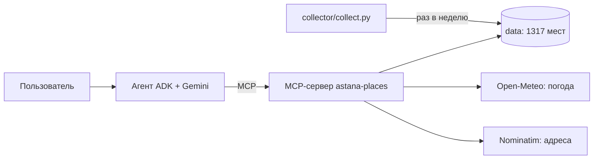

# Астана: ИИ-помощник по прогулкам

Агент на Google ADK и Gemini подсказывает, куда сходить в Астане рядом с пользователем. Он учитывает место, свободное время, способ передвижения, часы работы, погоду и ограничения: ребёнок, коляска, ночь, рейс. На каждый вопрос агент даёт 1-3 места и объясняет, почему туда стоит идти, сколько времени это займёт и что там сделать. Факты он берёт только из собранной базы через MCP-сервер. У каждого места указан источник, у часов работы указана степень уверенности.

Проект сделан для хакатона Build with AI (GDG Astana, задача НИЦ Smart City).

## Документы

| Что | Где |
|-|-|
| Концепция, RAG-подход, тестовые сценарии, ограничения, этика и приватность | [docs/document.md](docs/document.md) |
| Полные ответы агента в 12 тестовых сценариях | [docs/test_log.md](docs/test_log.md) |

## Как это работает



1. Сборщик скачивает места из OpenStreetMap, добавляет описания и популярность из Wikidata и Wikipedia, убирает дубли и закрытые места.
2. Агент находит в вопросе место, свободное время, способ передвижения и ограничения и вызывает инструмент search_places.
3. MCP-сервер находит место пользователя и отбирает места рядом. Для каждого он считает расстояние, время в пути и успевает ли человек посетить место. Ещё он проверяет, будет ли место открыто к приходу и насколько это точно, и смотрит погоду и темноту.
4. Gemini пишет короткий ответ по найденным фактам и помечает, что взято из базы, а что предлагает сам ИИ.

## Структура

| Путь | Что там |
|-|-|
| collector/collect.py | Автоматический сборщик данных, только стандартная библиотека Python |
| data/ | База: poi.json и poi.csv (места), anchors.json (ориентиры для поиска по названию), meta.json (статистика) |
| mcp_server/ | MCP-сервер astana-places: server.py (инструменты), places.py (поиск, часы работы, погода, маршрут) |
| agent/astana_guide/ | Агент Google ADK: инструкция, модели Gemini, подключение к MCP |
| mcp_config.json | Конфигурация MCP для MCP-клиентов: локально через stdio и в облаке через HTTP |
| deploy/deploy.py | Скрипт деплоя: MCP-сервер в Cloud Run, агент в Vertex AI Agent Engine (Reasoning Engine) |
| Dockerfile | Образ MCP-сервера для Cloud Run |
| .github/workflows/collect.yml | Автообновление данных каждый понедельник |
| docs/document.md | Документ проекта |

## Инструменты MCP

| Инструмент | Что делает |
|-|-|
| search_places | Основной инструмент. Находит место пользователя по названию и ищет места рядом. Учитывает время, часы работы, погоду, доступность и конечную точку, например аэропорт. Может сразу построить микро-маршрут |
| locate | Переводит название или адрес в примерные координаты, округлённые примерно до 100 м |
| plan_route | Строит маршрут через выбранные места: порядок, время прибытия, ссылка на Google Maps |

## Запуск локально

Нужны Python 3.12 и бесплатный ключ Gemini API из [Google AI Studio](https://aistudio.google.com/apikey). Команды выполняются из корня репозитория.

1. Создайте окружение:
   ```bash
   python -m venv .venv
   ```
2. Активируйте его: `.venv\Scripts\activate` в Windows или `source .venv/bin/activate` в macOS и Linux.
3. Установите зависимости:
   ```bash
   pip install -r agent/astana_guide/requirements.txt
   ```
4. Скопируйте agent/astana_guide/.env.example в agent/astana_guide/.env и впишите ключ в GOOGLE_API_KEY.
5. Запустите чат:
   ```bash
   adk web agent
   ```
6. Откройте http://localhost:8000, выберите astana_guide и спросите, например: «Я у Байтерека, есть час, что посмотреть?»

Агент сам запускает MCP-сервер через stdio, отдельно запускать его не нужно.

## Обновление данных

```bash
python collector/collect.py
```

Сборщик скачивает данные из Overpass API (есть запасные зеркала), Wikidata и Wikipedia и перезаписывает файлы в data/. В GitHub Actions он запускается каждый понедельник и коммитит изменения. Запустить его вручную можно на вкладке Actions.

## MCP-сервер отдельно

Через stdio, так его запускает агент:

```bash
python mcp_server/server.py --stdio
```

По HTTP, так он работает в Cloud Run. Адрес: http://127.0.0.1:8080/mcp

```bash
python mcp_server/server.py
```

Готовая конфигурация для MCP-клиентов лежит в mcp_config.json. Чтобы агент работал с удалённым сервером, впишите его адрес в MCP_URL.

## Деплой в Google Cloud

Нужны проект Google Cloud с включённой оплатой и [Google Cloud CLI](https://cloud.google.com/sdk/docs/install).

```bash
gcloud auth login --update-adc
```

```bash
gcloud auth application-default set-quota-project YOUR_PROJECT_ID
```

```bash
pip install -r deploy/requirements.txt
```

```bash
python deploy/deploy.py --project YOUR_PROJECT_ID
```

Скрипт делает три шага:

1. Включает API Cloud Run, Cloud Build, Artifact Registry и Vertex AI и создаёт хранилище образов, если его ещё нет.
2. Собирает образ MCP-сервера по Dockerfile и выкладывает его в Cloud Run как сервис astana-places.
3. Выкладывает агента в Vertex AI Agent Engine командой adk deploy agent_engine и передаёт ему MCP_URL, GEMINI_MODEL и GEMINI_LOCATION=global. Локальный .env с ключом в облако не попадает, там агент вызывает Gemini через Vertex AI от имени проекта.

Проверить агента в облаке можно вопросом из терминала. AGENT_ENGINE_ID скрипт деплоя печатает в конце.

```bash
python deploy/query.py --project YOUR_PROJECT_ID --agent AGENT_ENGINE_ID "Я у Байтерека, есть час, что посмотреть?"
```

**Развёрнутая версия.** 20.10.2026 проект развёрнут этим скриптом в проекте Google Cloud astana-walk-guide и проверен вопросом через deploy/query.py. Облачная версия работает, пока действует кредит хакатона, то есть до 20.10.2026 23:32.

| Что | Где |
|-|-|
| MCP-сервер в Cloud Run | https://astana-places-84430726061.us-central1.run.app/mcp |
| Агент в Vertex AI Agent Engine | projects/84430726061/locations/us-central1/reasoningEngines/7149803332909924352 |

Параметры скрипта:

| Параметр | По умолчанию | Зачем |
|-|-|-|
| --region | us-central1 | Регион Cloud Run и Agent Engine |
| --model | gemini-3.5-flash-lite | Основная модель агента в облаке |
| --mcp-url | нет | Взять готовый MCP-сервер и пропустить шаг Cloud Run |
| --agent-engine-id | нет | Обновить уже созданного агента вместо нового |

## Настройки

| Переменная | Где | Зачем |
|-|-|-|
| GOOGLE_API_KEY | agent/astana_guide/.env | Ключ Gemini API для локального запуска |
| GOOGLE_GENAI_USE_VERTEXAI | agent/astana_guide/.env | FALSE, если ключ из AI Studio |
| GEMINI_MODEL | agent/astana_guide/.env | Основная модель, по умолчанию gemini-3.5-flash-lite. При ошибке агент переходит на gemini-3.1-flash-lite, затем на gemini-3.5-flash |
| GEMINI_LOCATION | agent/astana_guide/.env | Регион Gemini в Vertex AI. Для ключа AI Studio оставьте пустым. Скрипт деплоя ставит global: модели Gemini 3 доступны там, а в us-central1 нет |
| MCP_URL | agent/astana_guide/.env | Адрес MCP-сервера по HTTP. Если пусто, агент запускает локальный сервер через stdio |
| HOST, PORT | MCP-сервер | Адрес HTTP-сервера, по умолчанию 127.0.0.1 и 8080 |
| POI_DATA_DIR | MCP-сервер | Папка с данными, по умолчанию data/ |

## Данные и лицензии

| Источник | Что берём | Лицензия |
|-|-|-|
| OpenStreetMap через Overpass API | Места, категории, часы работы, контакты, доступность | ODbL 1.0, © OpenStreetMap contributors |
| Wikidata | Достопримечательности, их типы, ссылки на статьи | CC0 1.0 |
| Wikipedia | Короткие описания и популярность (просмотры за 60 дней) | CC BY-SA 4.0 |
| Open-Meteo | Погода сейчас и прогноз | CC BY 4.0 |
| Nominatim | Поиск адресов, которых нет в базе | ODbL 1.0, не чаще 1 запроса в секунду |

## Ограничения

Часы работы известны у 20% мест, описания из Wikipedia есть у 5%. Время в пути считается по прямой с поправкой на улицы, без пробок. Подробно в [docs/document.md](docs/document.md).
